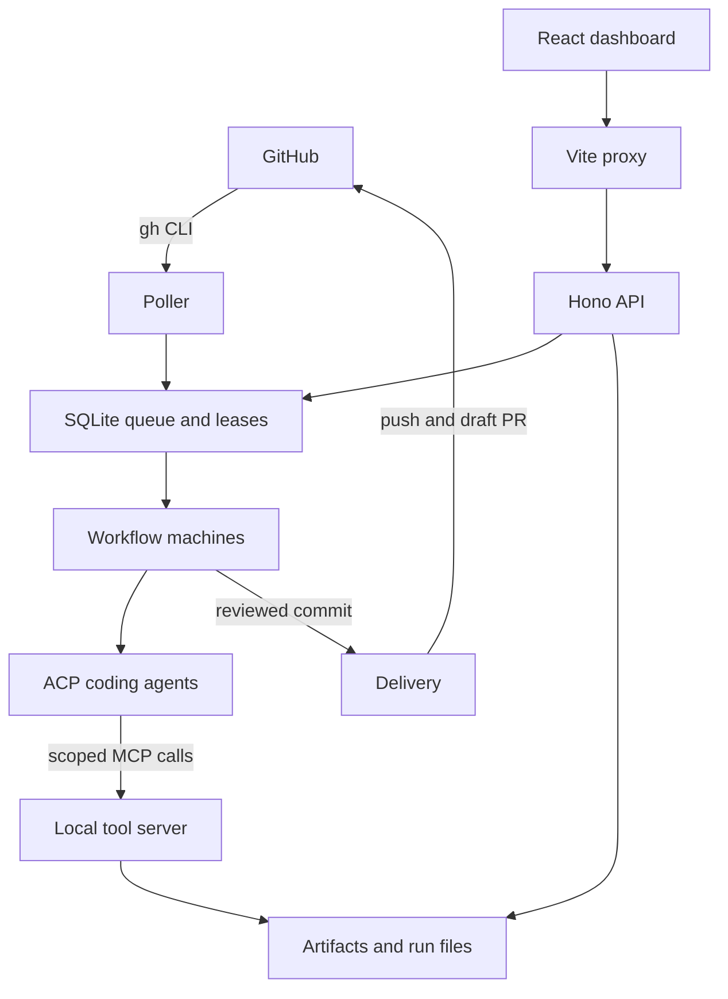
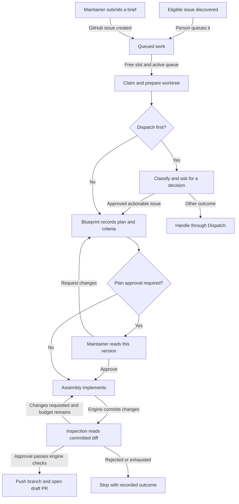
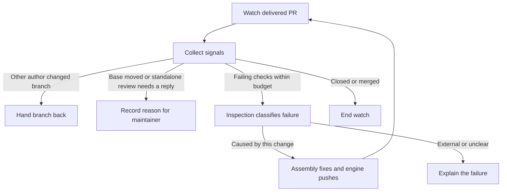
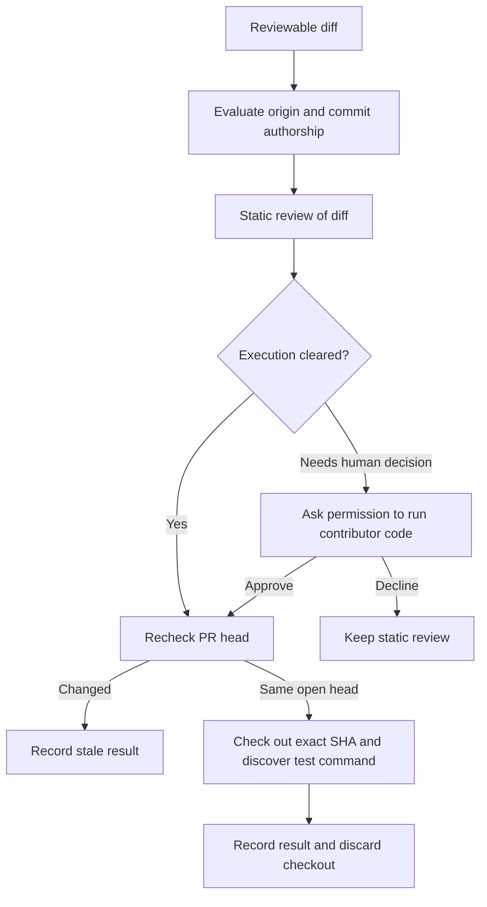
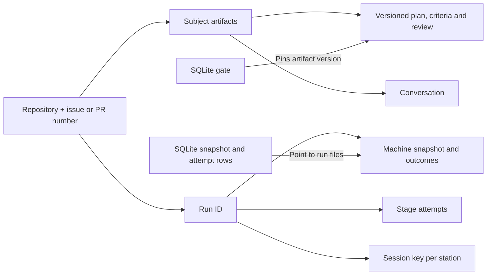

# Altimatrix architecture

One Bun process owns the poller, workflow execution and loopback HTTP API. GitHub is the source of issue and PR activity. The local database records which work the factory has accepted and what it can resume. The dashboard is an optional client of that same process.

**Reading paths.** To operate the factory, follow the [issue walkthrough](#from-discovery-to-a-draft) and [pull-request flows](#two-pull-request-workflows). To configure an agent, use the [station specifications and skills guide](docs/AGENTS_AND_SKILLS.md). For a local install, start with the [quick start](README.md#quick-start-from-source).

## Where to make a change

| Responsibility | Source | Design constraint |
| --- | --- | --- |
| Issue intake, scheduling, recovery | [watch](packages/core/src/watch), [queue](packages/core/src/modules/runs) | Filter PRs out of issue intake. Resume unfinished claims, cap the batch and advance the per-repo cursor only as far as processing permits. |
| Stage order and revisions | [machines](packages/core/src/run/machines), [policies](packages/core/src/run/policy.ts) | The issue, dispatch, delivered-PR and contributor-review paths have distinct state and stopping conditions. |
| Prompts and agent execution | [prompts](packages/core/src/prompts), [stage harness](packages/core/src/run/workflowStage.ts) | The harness supplies a working directory, session, permission mode, tool endpoint and timeout to the ACP provider. |
| Agent tools and outbound messages | [tool registry](packages/core/src/modules/tools/registry.ts), [outbound](packages/core/src/modules/outbound) | Register tools by station. Agent requests to comment are recorded for delivery under the applicable gate. |
| Storage and migrations | [database](packages/core/src/modules/db), [work files](packages/core/src/modules/work), [gates](packages/core/src/modules/gates) | Keep searchable state in SQLite and versioned, human-readable evidence on disk. |
| HTTP and browser | [routes](packages/core/src/server/routes), [dashboard](app/web/src), [launcher](scripts/dev-web.ts) | Hono exports the typed client contract. Vite proxies same-origin requests and adds the factory token. |

## From discovery to a draft

Consider an issue asking the project to show the reason a run stopped. Three entry points can bring it into the factory. They differ in who authorizes the work and when it starts.

| Entry point | What happens first | When work starts |
| --- | --- | --- |
| Watched GitHub issue | The poller screens an open issue by author association and required label, then records an offer. | A person queues or starts the offer. The scheduler claims queued work when capacity is available. |
| Dashboard brief | The composer creates a real GitHub issue in a watched repository, then enqueues it with the selected policy. | The composer tries to claim a free slot immediately. A paused or full queue leaves it waiting. |
| CLI single-issue run | `run OWNER/REPO NUMBER` fetches that issue directly and checks the global intake rules and claim. | The command drives the issue pipeline directly. Use it when you already know the issue number. |

The first poll looks back ten minutes. Subsequent polls use a repository cursor, with a default cap of 25 issue candidates per pass. A composite key of repository, subject kind and number makes rediscovery idempotent and distinguishes an issue from a PR. Queue promotion claims the oldest queued work with a capacity check in the same database statement. The default ceiling is two running entries, configurable from one to four. Pausing prevents new promotions while active work continues. [Poller](packages/core/src/watch/poll.ts) · [Queue operations](packages/core/src/modules/runs/queue.ts) · [Brief entry point](packages/core/src/server/routes/startWork.ts) · [Manual run](packages/core/src/runCommand.ts)

### Where people intervene

A run-specific mode takes precedence over the repository policy, then the factory default. The factory default is `automatic`; the new-work composer initially offers `plan_gate`. Automatic runs still produce a Blueprint plan.

| Dashboard choice | Policy | Decision in the example |
| --- | --- | --- |
| Start now | `automatic` | Blueprint records the plan, then Assembly begins immediately. |
| Plan first | `plan_gate` | Review the proposed UI change and its acceptance criteria before Assembly starts. |
| Talk it through | `talk` | Blueprint asks questions first. Clarify which screen needs the reason, then approve the resulting plan. |
| Dispatch first | `triage` | Dispatch classifies the report. Approving actionable work hands it to Blueprint. Other classifications can lead to a proposed reply, a wait for the reporter, or private escalation. |

A parallel watcher can send the issue machine back to planning or stop it when the premise changes. During a plan gate, a reply can extend the conversation. A revision produces a new artifact version and a new approval decision. Rejecting the plan stops that path. [Policy resolution](packages/core/src/run/policy.ts) · [Issue machine](packages/core/src/run/machines/issueWork.ts) · [Dispatch routing](packages/core/src/run/dispatchRoute.ts)

### What counts as delivery

For the example above, Blueprint might require that a stopped run displays its recorded reason. Assembly changes the dashboard and reports its checks. The engine commits the change locally. Inspection reads that commit from another checkout and supplies a pass or fail with evidence for each criterion. A request for changes can return to Assembly up to `maxRevisions` times (default two).

The engine checks the verdict and every supplied pass flag. It accepts an equal count of results and planned criteria as coverage. When the counts differ, it checks for missing normalized criterion text. An empty committed diff has nothing to publish. On a successful delivery, the engine pushes the branch and opens a draft PR containing the plan and review evidence. [Verdict check](packages/core/src/run/gate.ts) · [Delivery](packages/core/src/run/deliver.ts)

## Two pull-request workflows

**A draft created by Altimatrix** already has an implementation and a review. With `keepPullRequestsAlive` enabled (the default), the lifecycle machine watches it for subsequent signals. Signals arriving together are collected before a decision so the factory can consider a failing check alongside other feedback.

CI fixes have their own budget, `maxCiFixes` (default two). Automatic rebase and handling a batch consisting solely of review comments currently stop with an explanation. A person decides whether to merge. [PR lifecycle](packages/core/src/run/machines/prLifecycle.ts) · [CI actors](packages/core/src/run/machines/prActors.ts)

**A contributor PR** has a different starting point. Watching the repository creates offers for existing open PRs. Once started, the review path screens the description, measures the diff and can decline an empty change or one exceeding 1,200 changed lines or 40 files. Inspection can read the diff in a directory without a Git checkout.

Unattended execution requires a same-repository head, identifiable commit authors with sufficient repository permissions, and verified signatures by default. A trust approval applies to the reviewed head. If the checkout declares no supported test command, the result records that tests did not run. [Execution trust](packages/core/src/run/executionTrust.ts) · [Diff size rules](packages/core/src/run/prSize.ts) · [Review machine](packages/core/src/run/machines/prReview.ts)

## Persistence and recovery

A **subject** identifies a GitHub issue or PR. A **run** is one attempt to process that subject. A **station session** belongs to a station within a run. This distinction lets a maintainer reopen an issue's earlier plans while keeping retries and agent conversations attributable to the work that produced them.

| Store | Owns | Why it matters on restart |
| --- | --- | --- |
| SQLite under `ALTIMATRIX_STATE_DIR` | Settings, watched repositories, cursors, queue and leases, gate decisions, snapshot and attempt references, station session records | The poller resumes unfinished claims before offering new work. A durable gate can be answered from the CLI while the dashboard is closed. |
| State directory under `work/` | Artifacts grouped by subject, and machine snapshots and outcomes grouped by run | The engine can restore a recorded transition or reuse a completed attempt. Preserve this directory together with its database. |
| `ALTIMATRIX_WORKBENCH_DIR` | Repository clones and disposable Git worktrees | Recovery can adopt an existing worktree. A retained failed worktree lets a maintainer inspect what changed. |
| ACP session store | Persistent agent sessions keyed by run and station | Re-entering a station can resume its own context. A mid-turn permission question expires with the live turn. |

[Database schema](packages/core/src/modules/db/schema) · [Artifact paths](packages/core/src/modules/work/paths.ts) · [Recovery](packages/core/src/watch/resume.ts) · [CLI storage reference](packages/core/README.md#where-things-are-kept)

## Dashboard, API and trust boundary

`bun run dev:web` starts Vite and the factory. The browser sends same-origin requests to Vite, which attaches the factory bearer token and proxies them to the loopback Hono API. The dashboard reads queue state, gate decisions and work details through typed routes. Events provide updates during an agent turn. The launcher checks an authenticated route at startup so a different service on the configured port is detected.

Agents reach a different interface on the same server. Each turn receives a scoped MCP grant for its run, subject and station. The registry determines which records the agent may write. A station can propose a GitHub comment through an outbound tool, while the engine owns delivery. These restrictions govern the API. An agent's shell runs as the local user and can reach that user's files and authenticated programs. [Server](packages/core/src/server/serve.ts) · [Events](packages/core/src/events/bus.ts) · [Agent tools](packages/core/src/modules/tools/registry.ts) · [Security model](SECURITY.md)

## Open design directions

The earlier design proposed webhook intake, direct model-provider APIs, configurable branding and an official container distribution. These are proposals without a committed release date. Current setup uses polling, ACP agents, bundled assets and a local Bun runtime. Enforcing a shell sandbox would require an execution boundary outside the station permission settings.
