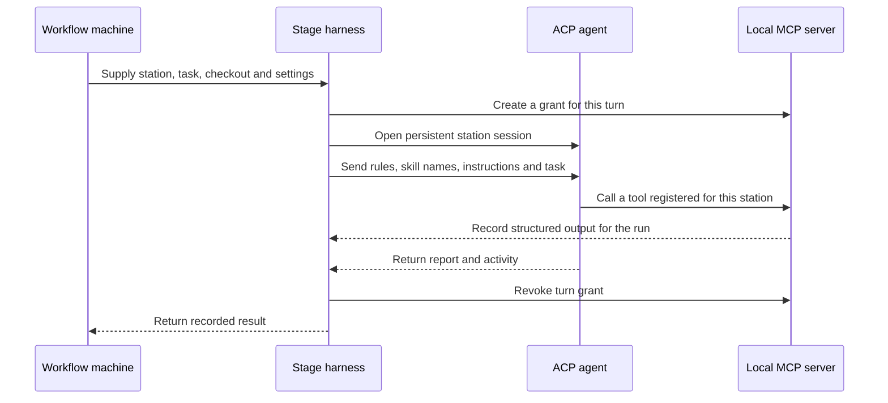

# Agent stations and skills

Use this guide to choose the agent behind a station, give it a repeatable procedure, and verify what the factory will ask it to do. Start with the [architecture walkthrough](../ARCHITECTURE.md#from-discovery-to-a-draft) for the order in which the stations run.

## One turn inside the factory

A station is a role in the workflow. An agent is the ACP-compatible program that performs it. Blueprint and Inspection can both use Codex and still have different tasks, working directories, sessions, permissions and tools.



This diagram follows a turn with the local tool server available. For structured stages, the harness prefers the tool result, can parse a structured reply as a fallback, and retries once after an unusable reply. A station's session key includes the run and station. A revision can therefore return to Assembly with its own prior context. [Stage harness](../packages/core/src/run/workflowStage.ts) · [Structured results](../packages/core/src/run/workflowStages/structured.ts)

## Station specifications

| Station and ID | Agent selection | What it receives | What the next step consumes |
| --- | --- | --- | --- |
| **Dispatch** · `classifier` | Uses `agents.analyst`. Its own skills, instructions and effort are configurable. | Issue, repository conventions and classification task under Dispatch-first policy | Classification, confidence, summary, reasoning, affected surface and missing information. A report may include a duplicate issue number or proposed reply. |
| **Blueprint** · `analyst` | `agents.analyst` | Issue, repository files, conventions and any feedback from the plan conversation | Problem statement, approach, steps, affected surface, risks, acceptance criteria and test strategy. A revised plan gets a new version. |
| **Assembly** · `implementer` | `agents.implementer` | Worktree, plan and criteria, plus Inspection feedback on a revision | Changes in the worktree, progress and an implementation report. The engine commits the changes for review. Assembly also handles an eligible CI fix. |
| **Inspection** · `reviewer` | `agents.reviewer` | Committed issue diff, plan and criteria. Contributor diff review and CI fault classification use separate tasks. | Issue verdict of `approve`, `request_changes` or `reject`, with criterion-level evidence, blocking findings and summary. CI classification yields `ours`, `theirs` or `unclear`. |

Dispatch recognizes `bug`, `feature`, `question`, `duplicate`, `security` and `noise`. Confidence is low, medium or high. A security classification takes the private escalation path. Only approved actionable work hands off to the issue pipeline. [Output schemas](../packages/core/src/run/workflowStages/schemas.ts) · [Classification values](../packages/core/src/shared/dispatchView.ts) · [Stage calls](../packages/core/src/run/workflowStages/index.ts)

### Tools and permissions

| Station | Station-specific MCP tools | Requested ACP permission mode |
| --- | --- | --- |
| Dispatch | `report_context`, `write_triage` | `approve-reads` |
| Blueprint | `report_context`, `write_plan` | `approve-reads` |
| Assembly | `start_step`, `report_progress`, `finish_step` | `approve-all` |
| Inspection | `write_review`, `answer_review_comment` | `approve-reads` |

All four receive `find_artifacts`, `read_artifact`, `append_conversation`, `comment_on_issue` and `reply_to_review`. The two outbound tools queue intents. A plan or review tool writes under the subject named by the grant. Changing the agent or adding a skill preserves the station's tool list. ACP permission handling and operating-system isolation are separate concerns. [Registry](../packages/core/src/modules/tools/registry.ts) · [Security model](../SECURITY.md)

## Give Inspection a review skill

Suppose you want every issue review to explain how the tests support the verdict. Use a short procedure that a reviewer can verify from the output.

1. In the local dashboard, open **Workflow → Inspection**. Under **Skills**, click **Add a skill**, enter `criterion-evidence` and press **Enter**.
2. Under **Instructions**, enter “For each acceptance criterion, cite the changed file and the check that supports your verdict. If a check was not run, say so.” Click outside the field to save it.
3. Under **Agent and reasoning effort**, choose the installed, signed-in agent you want to use. The picker offers `codex`, `claude` and `gemini`. All three configurable roles default to `codex`. The Dispatch picker displays “built in” because it follows Blueprint's agent selection.
4. Reopen Inspection to check the saved settings. Start a new Plan-first run on a small issue. Approve a criterion you can verify, then read the review artifact and compare its evidence to the criterion. To remove the assignment, use the remove button on the skill tag and edit the instructions.

**What the skill tag does.** Altimatrix adds the name to the station's system prompt on every turn that uses those settings. The entry alone supplies no procedure, executable or MCP tool. If the selected agent already provides a named skill, use that name and make it available through the agent's own setup. For a self-contained procedure like the example above, put the actual directions in **Instructions**. For a longer team procedure, commit it to the watched repository and name its path in the instructions so the agent can read the version belonging to that checkout.

The example skill name is illustrative. A saved tag verifies assignment. The resulting review evidence lets you assess whether the agent followed the procedure. [Workflow editor](../app/web/src/screens/workflow/Workflow.tsx) · [Skill input](../app/web/src/screens/workflow/workflow.components.tsx) · [Prompt assembly](../packages/core/src/run/workflowStageExtras.ts)

## Use the same configuration from a file

Save this example as `altimatrix.config.json` in the workspace root and replace `your-org/your-repo` with a repository you control. It watches issues labeled `agent-ready`, uses a plan gate, gives Assembly the shared effort and gives Inspection a higher effort plus its evidence procedure.

```json
{
  "watch": [
    {
      "repo": "your-org/your-repo",
      "policy": "plan_gate",
      "requireLabel": "agent-ready"
    }
  ],
  "maxParallelRuns": 1,
  "reasoningEffort": "medium",
  "agents": {
    "analyst": "codex",
    "implementer": "codex",
    "reviewer": "codex"
  },
  "stations": {
    "reviewer": {
      "skills": ["criterion-evidence"],
      "instructions": "For each acceptance criterion, cite the changed file and the check that supports your verdict. If a check was not run, say so.",
      "reasoningEffort": "high"
    }
  }
}
```

From the workspace root, the first command checks the configuration alongside Git and GitHub authentication. The second starts the dashboard using that file. The absolute path matters because the launcher starts the factory in the core package directory.

```sh
ALTIMATRIX_CONFIG="$PWD/altimatrix.config.json" bun run packages/core/src/index.ts doctor
ALTIMATRIX_CONFIG="$PWD/altimatrix.config.json" bun run dev:web
```

By default, settings live in SQLite. With this explicit override, settings edits are written back to the named JSON file. Run state still lives in SQLite and the work directory. Station configuration applies across this factory's watched repositories. Put repository-specific conventions in the target repository.

| Setting | Scope and limits |
| --- | --- |
| `agents` | Three agent IDs for analyst, implementer and reviewer. The runtime must be able to launch and authenticate the selected agent. |
| `stations.<id>.skills` | Up to 20 names, each 1–60 characters. Default is an empty list. |
| `stations.<id>.instructions` | Up to 4,000 characters. Default is empty. Included alongside the skill names in the system prompt. |
| `reasoningEffort` | Shared default is `high`. Choices are `low`, `medium`, `high` and `xhigh`. A station override wins. If the provider rejects the effort option, the harness logs it at debug level and continues. |
| `turnTimeoutMs`, `askOnPermission` | Default timeout is 900,000 ms. Opting into permission questions lets a live turn wait for a bounded human decision. |
| Repository convention files | The factory looks for `AGENTS.md`, `CLAUDE.md`, `.github/copilot-instructions.md`, `.cursorrules`, `.cursor/rules/*.mdc` and `.github/instructions/*.md` and names discovered paths in the prompt. |

[Settings schema](../packages/core/src/modules/settings/domains.ts) · [Configuration loader](../packages/core/src/config.ts) · [Convention discovery](../packages/core/src/run/conventions.ts) · [Full configuration reference](../packages/core/README.md#settings)

## Extending a station in the codebase

For a new **review procedure**, start with the station settings above. For a new **structured action** that the engine must validate and store, follow an existing station tool such as `write_plan` from registration through recording and recovery.

| Change | Implementation and verification |
| --- | --- |
| Change what a station asks the agent to do | Update the relevant prompt and stage call. Exercise a follow-up turn if the instruction should persist across revisions. [Prompts](../packages/core/src/prompts) · [Stage implementations](../packages/core/src/run/workflowStages) |
| Change a recorded contract | Update the schema, corresponding tool handler and consumers. Consider saved results from runs created before the change. [Schemas](../packages/core/src/run/workflowStages/schemas.ts) · [Record handlers](../packages/core/src/modules/tools/records.ts) |
| Add a station-specific tool | Register the handler, add the name to the intended station's allowlist, and verify that the intended station can invoke it while another cannot. [Registry](../packages/core/src/modules/tools/registry.ts) · [Tool tests](../packages/core/test/tools.test.ts) |
| Change a default or setting | Update the domain schema and applicable settings API and dashboard control. Exercise a settings object created before the field existed. [Settings route](../packages/core/src/server/routes/settingsRoute.ts) · [Compatibility tests](../packages/core/test/configWorkflowStages.test.ts) |

From the workspace root, run `bun run test` for the contracts and `bun run eval` for workflow behavior. The [contributor guide](../CONTRIBUTING.md) lists the full verification suite.
